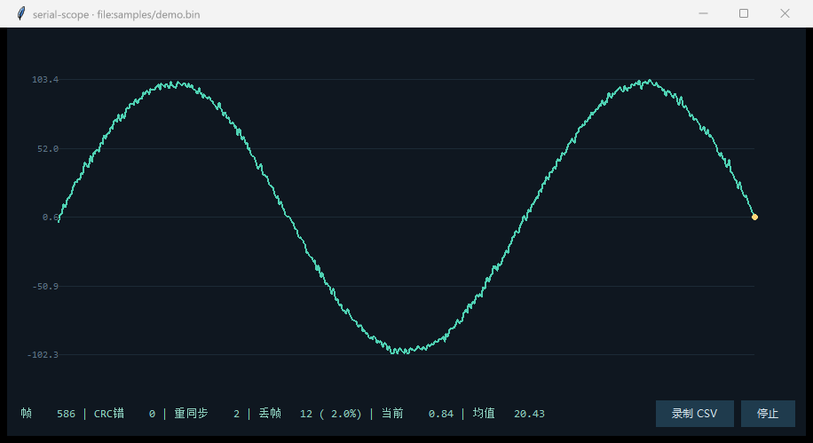

# serial-scope · 串口数据采集上位机

[](https://github.com/kesheC/serial-scope/actions/workflows/ci.yml)

一个**带协议层**的串口数据采集与实时显示上位机：下位机按自定义帧格式吐采样，上位机负责流式解码、CRC 校验、丢帧统计、实时曲线与 CSV 录制。纯 Python 标准库实现（串口可选 `pyserial`），没有显示器或没有硬件时用内置模拟器跑通全链路。



*上图是回放 `samples/demo.bin` 的实际界面：右下角统计行显示 586 帧、2 次重同步、12 帧丢失（2.0%），曲线是解码后的采样值。*


```
                    ┌──────────────── serial-scope ─────────────────┐
 下位机 / 模拟器       │                                              │
 ├ AA 55 01 01 ... ──▶│ Source.read() ─▶ FrameDecoder.feed()         │
 │  (帧流, 可任意切分) │                    │ 半帧等待 / 噪声重同步      │
 └───────────────────┘                    │ CRC16 校验 / 异常长度拒绝   │
                                          ▼                          │
                                   LossStats(seq)  ──▶ 丢帧率          │
                                          │                          │
                                   SampleWindow(环形缓冲) ──▶ 曲线      │
                                          │                          │
                                   queue ─▶ Tk 渲染线程               │
                                          └──▶ Recorder → CSV         │
                    └──────────────────────────────────────────────┘
```

## 帧协议

| 字段 | 长度 | 说明 |
| --- | --- | --- |
| `magic` | 2 B | 固定 `0xAA 0x55`，用于在噪声流中定位帧起点 |
| `ver` | 1 B | 协议版本，当前 `0x01`，为后续加字段留余地 |
| `type` | 1 B | `0x01` 采样帧（payload = float32 LE）、`0x02` 状态帧（utf-8 文本） |
| `seq` | 2 B | 单调自增（uint16，回绕），**丢帧统计的依据** |
| `len` | 2 B | payload 长度（上限 4096，防异常长度把解析器卡死） |
| `payload` | len B | 载荷 |
| `crc16` | 2 B | CRC-16/MODBUS，覆盖 `ver..payload`（帧头不参与） |

## 快速开始

```bash
# 1. 没有硬件：用模拟器（自带噪声字节与 5% 丢帧，用来验证统计链路）
python -m serialscope --demo

# 2. 无界面快速验证（CI / 无显示器 / 排查链路）
python -m serialscope --demo --headless --seconds 3
# simulator 3s → 帧=147 CRC错=0 重同步=0 丢帧=7 (4.5%) 最新=13.60 均值=1.91

# 3. 接真实串口（需要 pip install pyserial）
python -m serialscope --port COM3 --baud 115200

# 4. 回放抓包文件
python -m serialscope --file dump.bin

# 5. 测试
python -m unittest discover -s tests -t .
```

界面：左侧实时曲线（环形缓冲最近 600 点），底部一行统计 `帧 / CRC错 / 重同步 / 丢帧(率) / 当前值 / 均值`，右侧「开始/停止」与「录制 CSV」。记录的 CSV 是 `timestamp_ms,seq,value`，可以直接丢进 pandas 或 Excel 二次分析。

## 实现要点

- **丢帧用 seq 算，不用时间戳**：两端时钟不同源，`(seq - expected) & 0xFFFF` 天然支持 uint16 回绕。
- **解码器做成流式**：一次 `read()` 可能半帧也可能十帧；帧头错位、CRC 失败、长度异常时丢 2 字节重找帧头，不清空缓冲（清空会把后面的好帧一起丢掉）。`feed()` 用 `Frame / None / False` 三态区分「解出帧 / 等数据 / 丢坏字节重试」。
- **CRC 只覆盖 `ver..payload`**：帧头负责定位，错位时解析器自己会重同步，不需要让它参与校验。
- **读线程只解析、UI 只渲染**：串口是阻塞 IO，放进 UI 线程会卡界面。帧通过 `queue` 交接，队列满时丢显示帧、统计仍完整。
- **长度字段有上限**：噪声里撞出的假帧头可能带巨大长度，`MAX_PAYLOAD=4096` 直接拒绝并计入 `bad_lengths`，避免「卡死但没报错」。
- **用 Tk 不用 Qt/Web**：调试工具要「拷走就能跑」，Tk 随 Python 自带，牺牲观感换部署成本。

## 测试

23 个用例：协议层（CRC 标准向量、编解码往返、逐字节喂入、半帧等待、噪声重同步、CRC 错恢复、异常长度、截断输入）、链路层（帧计数、环形窗口、状态帧不污染采样）、IO 层（窗口统计、CSV 格式、文件回放）。

```bash
python -m unittest discover -s tests -t .   # Ran 23 tests ... OK
```

## 已知边界

- 单通道：`TYPE_SAMPLE` 只有一个 float32。多通道需要改 payload 布局并同步改 `Frame.sample`。
- 不做波特率自适应：速率不匹配表现为持续 `resyncs` 上涨，需要人工确认。
- 界面用 Tk 绘制，点数超过约 5000 时重绘会有可感知延迟；当前环形缓冲限制在 600 点。
- CSV 录制不做断点续写与文件轮转，长时间采集需自行控制。

